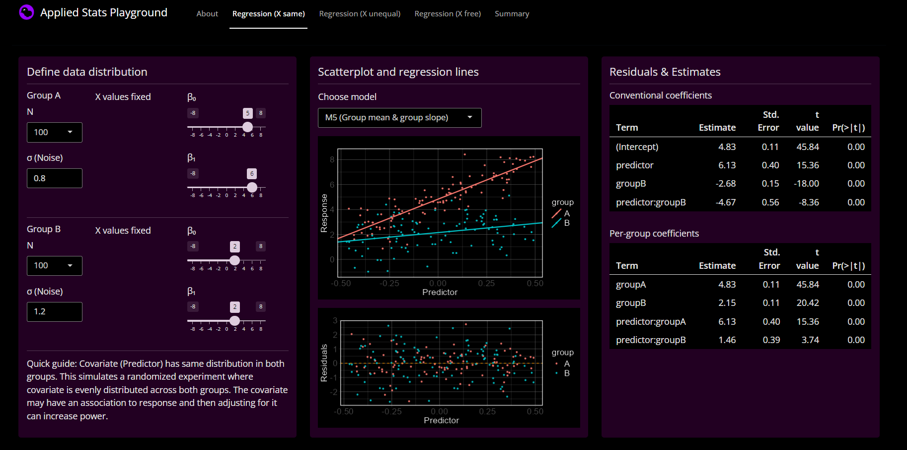

# Applied Stats Playground

### Features
This Shiny web-app offers an interactive exploration of the strengths and limitations 
of linear regression. Users can generate simulated datasets with different 
underlying structures, involving one grouping variable and one continuous 
predictor. They can fit and compare regression models of varying complexity, 
assessing their suitability for each scenario through visualisations and summary tables.

### Dependencies
- R 4.5.1
- tidyverse
- shiny
- bslib

### Data Source
- Simulated data, no external data needed.

### Installation
* Install R and Rstudio (and git)
* In Terminal/cmd/bash: Clone this repository
* Open this repo in Rstudio as a project (e.g. double-click **didactic_stats_app.Rproj**)
* In R console:
  * Activate renv: ```renv::activate()```
  * Check needed R packages: ```renv::status()```
  * Install packages from renv.lock: ```renv::restore()```

### Usage - Start app (with R-studio)
Open repo in Rstudio as a project (e.g. double-click ```didactic_stats_app.Rproj```)

Easiest is to open app.R and then use the "Run app" button

For more control, use Rstudio's terminal and do

```bash
Rscript --no-init-file -e "shiny::runApp(launch.browser = TRUE)"
# or 
Rscript --vanilla -e "shiny::runApp(launch.browser = TRUE)"
```

More arguments can be provided, e.g.:

```bash
Rscript --vanilla -e "shiny::runApp(launch.browser = TRUE, port = 3838, host = '127.0.0.1')"
```

### Usage - Start app (with PowerShell)

Navigate to dir containing Rscript.exe

```bash
cd <dir containing Rscript.exe>
```

Example ```cd "C:\Program Files\R\R-4.5.1\bin\"``` path many vary on each computer.

Install dependencies (skip if you already executed installation steps above)

```bash
.\Rscript -e "renv::restore(project = '.../didactic_stats_app')"
```

Call Rscript with repo path as argument to runApp(), below replace ... by your path to repo

```bash
.\Rscript --no-init-file -e "shiny::runApp(appDir = '.../didactic_stats_app', launch.browser = TRUE)"
```


### Project Structure

```text
didactic_stats_app/
│
├── app.R                    # Main application entry point
├── pages/                   # UI definitions for app pages
├── server/                  # Server-side logic with page-specific functionality
├── src/                     # Shared functions and components
├── resources/              # static items: pics, codebooks etc.
│
├── renv/                    # Project-specific package environment
├── renv.lock                # Package versions and dependency snapshot
├── .Rprofile                # R startup config (used for renv activation)
│
├── .gitignore               # Files excluded from version control
├── didactic_stats_app.Rproj # RStudio project configuration
├── readme.md
└── LICENSE
```


### Credits
- Web-app concept, analytics and implementation by Serge Zaugg ([Pollito-ML](https://github.com/sergezaugg))

### License
[MIT License - © 2026 Serge Zaugg](LICENSE)

### Preview



